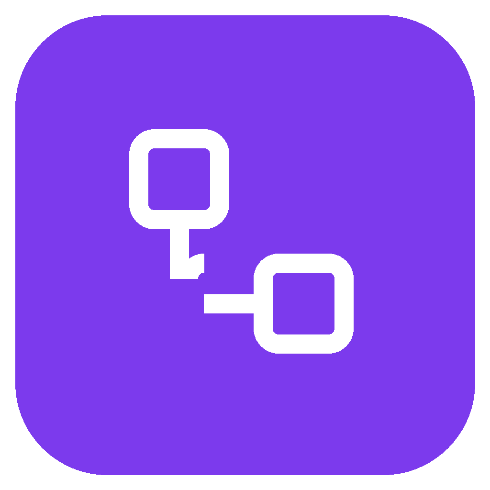
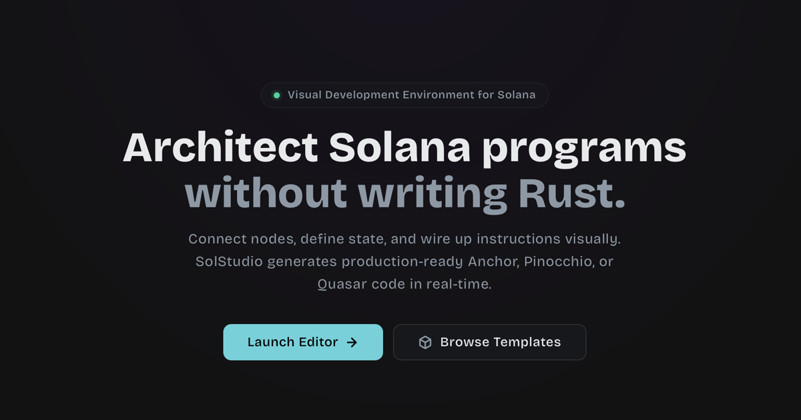
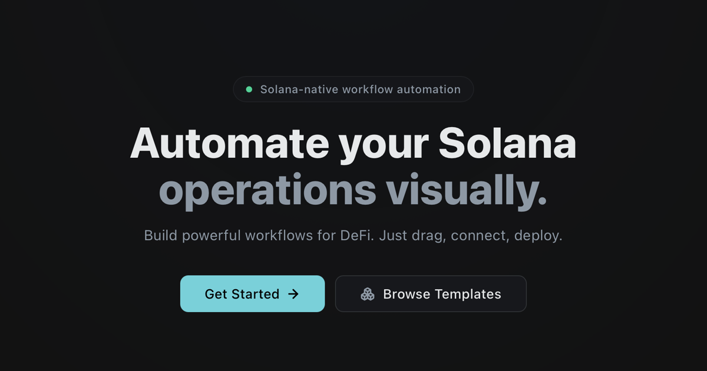
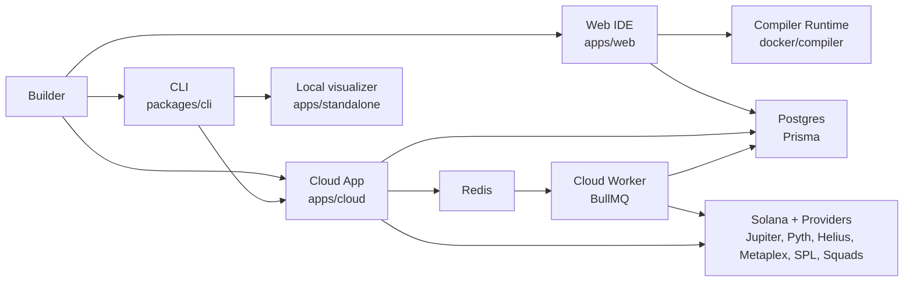

<p align="center">
  
</p>

<h1 align="center">SolStudio</h1>

<p align="center">
  Draw a Solana program, ship it to devnet, and automate it. A visual Web IDE, a local CLI, and a workflow Cloud for Solana.
</p>

<p align="center">
  <a href="https://solstudio.fun">Web IDE</a>
  |
  <a href="https://cloud.solstudio.fun">Cloud</a>
  |
  <a href="https://www.npmjs.com/package/@solstudio/cli">CLI</a>
  |
  <a href="./apps/web/src/app/docs">Docs</a>
  |
  <a href="./docs/PROJECT_INDEX.md">Project Index</a>
</p>

<p align="center">
  
  
</p>

## Watch

| [](https://youtu.be/9htekrWTdWI) | [](https://youtu.be/Wr-VZ1PzHLM) |
| :---: | :---: |
| **[Launch film](https://youtu.be/9htekrWTdWI)** (1 min) | **[Web IDE walkthrough](https://youtu.be/Wr-VZ1PzHLM)**: draw a program, deploy to devnet |
| [](https://youtu.be/2i-HtmPjaxg) | [](https://youtu.be/NjBxIW_7wEQ) |
| **[CLI walkthrough](https://youtu.be/2i-HtmPjaxg)**: audit any Anchor repo, locally | **[Cloud walkthrough](https://youtu.be/NjBxIW_7wEQ)**: cron, webhooks and replay |

## Contents

1. [What this is and who it's for](#1-what-this-is-and-who-its-for)
2. [Story and inspiration](#2-story-and-inspiration)
3. [Problem](#3-problem)
4. [Solution](#4-solution)
5. [How it works](#5-how-it-works)
6. [Target users](#6-target-users)
7. [Features](#7-features)
8. [Addresses and revenue](#8-addresses-and-revenue)
9. [Sponsor and partner integrations](#9-sponsor-and-partner-integrations)
10. [Tech stack](#10-tech-stack)
11. [Architecture](#11-architecture)
12. [Competitors](#12-competitors)
13. [Go to market](#13-go-to-market)
14. [Business model](#14-business-model)
15. [Roadmap](#15-roadmap)
16. [Team](#16-team)
17. [Run locally](#17-run-locally)
18. [Verify and tests](#18-verify-and-tests)
19. [Repo layout](#19-repo-layout)
20. [Security notes](#20-security-notes)
21. [License](#21-license)

## 1. What this is and who it's for

SolStudio is a development and automation platform for Solana with three connected surfaces:

| Surface | Where | What it does |
| --- | --- | --- |
| **Web IDE** | [solstudio.fun](https://solstudio.fun), `apps/web` | Design a program as a graph and get real Anchor, Pinocchio, or Quasar code. Audit, test, compile, and deploy to devnet. Then generate the IDL and a TypeScript SDK, and simulate transactions against the deployed program. |
| **CLI** | `@solstudio/cli`, `packages/cli` | Point it at an existing Anchor, Pinocchio, or Quasar repo. It parses the program into the same graph, audits it, runs your tests, writes CI, and opens a local visualizer. Your code never leaves your machine. |
| **Cloud** | [cloud.solstudio.fun](https://cloud.solstudio.fun), `apps/cloud` | n8n-style workflow automation for Solana. It has cron, webhook and manual triggers, and nodes for Jupiter, Pyth, Helius, Metaplex, Squads and Jito. Runs get safety limits and preflight checks, credentials and wallets are encrypted, and every run can be replayed. |

It is for three groups:
- Solana developers who want to see and check what they build.
- Teams who want automations without running their own bots.
- Newcomers who learn faster from a picture than from boilerplate.

## 2. Story and inspiration

<!-- TODO(owner): replace with your own words. Draft based on the repo history: -->

SolStudio started as **SolFlow**, an experiment in drawing an Anchor program instead of typing it. The first lesson was that the hard part of Solana is not the syntax but the account model:
- which accounts an instruction touches;
- which accounts must sign;
- which are PDAs, and with what seeds;
- which constraints protect them.

Those relationships are easy to draw and hard to keep in your head.

The visual builder grew a code generator, then an auditor, then a compiler and deployer. Users then asked to visualize programs they had already written, which became the CLI. Once programs were live, the next need was to *operate* them (watch prices, react to deposits, alert a team), which became SolStudio Cloud.

## 3. Problem

- **Solana programs are hard to reason about.** Accounts, signers, PDAs, seeds, bumps, and constraints live in macros spread across files. A missing `signer` or an unchecked amount is a one-line bug with real money behind it.
- **The toolchain is heavy for newcomers.** Rust, the Solana CLI, Anchor, `cargo build-sbf`, a local validator, and deploy keys all have to work before the first deploy.
- **Security review comes late.** Most teams audit after the code is written, not while it is being designed.
- **Framework choice is a one-way door.** Moving a program from Anchor to Pinocchio for compute savings means a rewrite.
- **Operating a program means writing bots.** Price alerts, scheduled jobs, webhook handlers, and treasury flows each become a custom script with its own keys, retries, and logs.

## 4. Solution

- **See the program.** Instructions, accounts, constraints, state, events, and logic are nodes and edges. That holds both when you design a program and when you import an existing repo.
- **Generate real code in three frameworks.** One graph produces Anchor, Pinocchio, or Quasar code that compiles with the real toolchain.
- **Audit while you design.** Static rules run in the browser or the CLI, along with deterministic stress probes: missing signer, wrong PDA seed, missing bump, out-of-range amounts. Each finding points back to its node and its code.
- **Ship from the browser.** Compile in the cloud, deploy to devnet, inspect the IDL, generate an SDK, and simulate transactions before signing anything.
- **Automate with guardrails.** Cloud workflows run on a schedule, a webhook, or a click. Every run gets a preflight report, simulation before signing, manual approval, and spend and slippage limits.

## 5. How it works

**Web IDE**

1. Start a project, or fork a marketplace template.
2. Drag in instructions, accounts, state, constraints, and logic blocks, and wire them together.
3. The graph becomes an intermediate representation (`packages/ir`), which the code generator (`packages/codegen`) turns into Anchor, Pinocchio, or Quasar code.
4. The auditor (`packages/audit`) checks the IR. The compiler service builds the program, and the deployer writes it to devnet.
5. The IDL, Codama SDK, Tx Builder, and Inspector work against the deployed program.

**CLI**

1. `solstudio parse .` reads every Rust file with the Rust parser (`packages/rust-parser`) and builds the same graph.
2. `solstudio audit .` runs the same rules plus 30 stress probes. Output can be a summary, JSON, Markdown, or SARIF.
3. `solstudio view .` opens the local visualizer (`apps/standalone`). From there you can edit code, save and re-parse, then compile, test, and deploy with your own toolchain.
4. `solstudio ci --write` adds a GitHub Actions workflow that parses, audits, and tests every pull request.

**Cloud**

1. Start from a template, from a sentence in the workflow assistant, or from a blank canvas.
2. Set safety limits and run preflight. Then run it, schedule it with cron, or activate a webhook URL.
3. A BullMQ worker executes the graph node by node (`packages/cloud-engine`). Every input, output, log, and timing is stored and can be replayed.

## 6. Target users

- **Solana program developers** who want design-time feedback, faster scaffolding, and a second pair of eyes on account security.
- **Teams moving between frameworks**, for example Anchor to Pinocchio for compute savings.
- **Hackathon builders and students** who need to go from idea to devnet in an afternoon.
- **Protocol and DAO operators** who need alerts, scheduled jobs, webhook handlers, and treasury approval flows without maintaining bots.
- **Auditors and reviewers** who want a map of a codebase before reading it line by line.

## 7. Features

**Web IDE**
- Visual builder with nodes for programs, instructions, accounts, state, constraints, events, logic, errors, and custom code.
- Code generation for Anchor, Pinocchio, and Quasar from one graph, with a side-by-side compare view.
- Instant and full audits: static rules plus deterministic stress probes, each linked to its node and code.
- Generated tests (smoke and simnet), cloud compile, and one-click devnet deploy.
- Post-deploy tools:
  - IDL in Anchor and Codama formats.
  - TypeScript SDK generation with Codama.
  - Tx Builder that simulates and sends transactions.
  - On-chain account Inspector.
- Version history, read-only share links, and a zip export with the program, SDK, IDLs, tests, and IR.
- IDL import: Anchor (including the 0.30+ spec), Shank, Kinobi, and Codama.
- Marketplace of forkable templates: vaults, escrows, token mint, NFT collection, staking, DAO voting, and an AMM.
- Plugins (SPL Token, Metaplex, Pyth) and a built-in browser for docs, explorer, and faucet.

**CLI** (`@solstudio/cli`)
- Project commands:
  - `parse`, `idl`, `view`, `init` and `test`.
  - `audit`: summary, JSON, Markdown or SARIF output, plus generated tests.
  - `doctor`, which checks your local toolchain.
  - `ci`, which writes a GitHub Actions workflow.
  - `patch`: dry-run framework migration diffs.
- `cloud` commands:
  - Account: login, whoami, status.
  - Workflows: create, run, activate, import, export.
  - Executions, credentials, wallets, and the node catalog.
  - Agent instructions and a self-host stack generator.

**Cloud**
- 24 workflow templates and 50+ nodes:
  - Jupiter: price, search, swap order, build, execute.
  - Oracles: Pyth and Switchboard.
  - Helius: RPC, webhooks, transactions.
  - Metaplex DAS, SPL token accounts, Squads proposals, Jito bundles.
  - Notifications: Discord, Telegram, Dialect.
  - HTTP, AI agents, and logic and transform nodes.
- Triggers: cron, webhook (custom path, header auth, replay protection, body size limits), and manual.
- Workflow safety: simulation before signing, manual approval, spend and slippage limits, mint and webhook allowlists.
- A preflight report before any run, covering risk, fees, wallet actions, external calls, and the planned path.
- Rule-based workflow assistant that turns a sentence into an editable graph.
- Encrypted credentials and cloud wallets (AES-256-GCM), with secrets redacted from logs.
- Execution history with step-by-step replay of every node's input, output, and timing.

## 8. Addresses and revenue

<!-- TODO(owner): fill in before launch. Do not commit private keys; public addresses only. -->

| Item | Network | Address |
| --- | --- | --- |
| Treasury | mainnet-beta | Coming soon |
| Platform fee recipient | mainnet-beta | Coming soon |
| Token mint | mainnet-beta | Coming soon |
| Demo vault program deployed from the Web IDE | devnet | `78yF5C5sWZadBm6KT6mg7k2ouGA2SN1BC2nVnt2aH4oV` |

Revenue policy: details will be published here with the treasury address.

## 9. Sponsor and partner integrations

SolStudio integrates with the protocols and tools below. A listing means a technical integration only, not an endorsement or partnership, unless stated otherwise.

| Integration | Used for |
| --- | --- |
| Anchor, Pinocchio, Quasar | Code generation, parsing, and build targets |
| Codama / Kinobi, Shank | IDL formats and TypeScript SDK generation |
| Solana Playground build service | Cloud compilation in the Web IDE |
| Surfpool | Local simnet for tests (Linux) |
| Jupiter | Price, token search, swap order, build, and execute nodes |
| Pyth, Switchboard | Oracle price nodes |
| Helius | RPC, webhooks, enhanced transactions, and DAS |
| Metaplex | Digital asset (DAS) nodes |
| Squads | Multisig proposal node |
| Jito | Tip accounts, bundle send, and status nodes |
| DexScreener, Birdeye | Price data for alert workflows |
| Discord, Telegram, Dialect | Notification nodes |
| OpenAI, Anthropic, Gemini, DeepSeek | Optional AI agent nodes and the editor assistant |

<!-- TODO(owner): add formal sponsors, grants, and hackathon results here with links. -->

## 10. Tech stack

| Layer | Stack |
| --- | --- |
| Runtime | Bun 1.3, TypeScript |
| Frontend | Next.js 15, React 19, Tailwind CSS 4, React Flow (`@xyflow/react` 12), Monaco |
| Backend | Next.js route handlers, tRPC, Prisma, PostgreSQL |
| Cloud execution | BullMQ, Redis, embedded or standalone worker |
| Solana | `@solana/kit`, `@solana/web3.js`, wallet adapter, Anchor 0.31/0.32 toolchain, `cargo build-sbf`, Codama |
| Auth | NextAuth v5 with OAuth and Solana wallet sign-in |
| Deployment | Docker Compose (web, cloud, worker, compiler, Redis) with a standalone Next.js output |

## 11. Architecture



The Web IDE and the CLI share the same core pipeline:

```text
Rust source / IDL ──► rust-parser / idl-import ──► flow graph ◄──► visual editor
                                                   │
                                                   ▼
                                                  IR ──► codegen (Anchor | Pinocchio | Quasar)
                                                   └───► audit (rules + stress probes) ──► tests
```

## 12. Competitors

| Product | Overlap | How SolStudio differs |
| --- | --- | --- |
| Solana Playground | Browser editor, build, and deploy | Visual design, three framework targets from one graph, built-in audits, and a local CLI for existing repos |
| Anchor CLI | Scaffolding, build, test, IDL | SolStudio wraps it and adds visualization, audits, CI, and SDK and transaction tooling on top |
| Codama | IDL and client generation | Used by SolStudio for SDKs; SolStudio adds design, audit, and deploy |
| Static analyzers (for example Sec3 X-ray, Radar) | Security scanning | SolStudio checks at design time, links findings to the graph, and generates stress tests |
| n8n, Zapier | Workflow automation | Solana-native nodes, wallets, safety limits, preflight, and replay |
| Helius webhooks | Event triggers | One trigger source; SolStudio Cloud chains triggers into multi-step workflows |

## 13. Go to market

<!-- TODO(owner): adjust to the actual launch plan. -->

- **Developers first.** The CLI is free and local, so it's easy to try on an existing repo. Its GitHub Actions output (SARIF and CI) brings SolStudio into teams' pull requests.
- **Templates as distribution.** Marketplace and Cloud templates are shareable, and target searches like "Solana vault", "escrow" or "price alert".
- **Hackathons and education.** Builders go from idea to devnet in an afternoon, with visual explanations of accounts and PDAs.
- **Content.** Walkthrough videos for each surface, plus short clips of audits catching real bugs.
- **Ecosystem integrations.** Each protocol node (Jupiter, Pyth, Helius, Squads, Jito) is a co-marketing opportunity.

## 14. Business model

<!-- TODO(owner): confirm pricing. -->

- **Free:** CLI, Web IDE design, codegen, audits, and devnet deploys.
- **Pro (subscription):** more Cloud executions and active workflows, private projects, full audits, and team seats.
- **Usage-based Cloud:** per-run pricing above plan limits for high-frequency workflows.
- **Marketplace:** paid templates with a platform fee.
- **Self-host and enterprise:** the self-host stack with support, SSO, and audit log retention.

## 15. Roadmap

- Mainnet deploy flow with multisig (Squads) upgrade authority.
- Visualizer and editor UI/UX refresh across Web, Cloud, and CLI.
- Persisted compile and deploy state per project.
- Richer workflow assistant (more intents, AI-backed generation).
- Live run updates in the Cloud editor for cron and webhook runs.
- Marketplace previews and thumbnails, ratings, and creator payouts.
- More frameworks and IDL formats; a Pinocchio-first optimization advisor.
- Publish the latest CLI fixes to npm.

## 16. Team

| Name | Role | Links |
| --- | --- | --- |
| Singupalli Kartik | Founder & CEO | [GitHub](https://github.com/skartik-sk) · [X](https://x.com/skartik_sk) · [LinkedIn](https://www.linkedin.com/in/skartik-sk/) · [Telegram](https://t.me/skartik_sk) |

## 17. Run locally

### Prerequisites

- Bun `1.3.10` or newer
- PostgreSQL
- Redis, required for Cloud workflow queues
- Docker, optional, for production-style runs and the compiler image
- For local compile, test, and deploy from the CLI: Rust, the Solana CLI, Anchor, and `cargo-build-sbf` (`solstudio doctor` checks them)

### Install

```bash
bun install
cp .env.example .env
bun run db:generate
bun run db:seed:all
```

Update `.env` with your database URL, auth secret, OAuth credentials, and optional provider keys.

### Web IDE

```bash
bun run --cwd apps/web dev        # http://localhost:3000
```

### Cloud

```bash
docker run --name solstudio-redis -p 6379:6379 redis:7-alpine
bun run --cwd apps/cloud dev      # http://localhost:3001
```

### CLI and local visualizer

```bash
bun run --cwd packages/cli build
bun run --cwd packages/cli solstudio view ./path-to-solana-project
```

Or install the published CLI: `bun add -g @solstudio/cli`.

### Environment variables

Start from `.env.example` for local development and `.env.production.example` for production.

| Variable | Required | Purpose |
| --- | --- | --- |
| `DATABASE_URL` | Yes | PostgreSQL connection string for Prisma. |
| `AUTH_SECRET` | Yes | NextAuth signing secret. |
| `AUTH_URL` | Yes | Canonical auth URL for the active app. |
| `ENCRYPTION_MASTER_KEY` | Yes for Cloud | 32-byte hex key that encrypts Cloud credentials and wallets. |
| `REDIS_URL` | Yes for Cloud runs | Redis for BullMQ (password, db index, and `rediss://` TLS are honored). |
| `NEXT_PUBLIC_SOLANA_RPC_URL` | Recommended | Default Solana RPC endpoint. |
| `NEXT_PUBLIC_SOLANA_NETWORK` | Recommended | `devnet` or `mainnet-beta`. |
| `COMPILER_SERVICE_URL` | Web compile | Optional remote compiler URL. |
| `AUTH_COOKIE_DOMAIN` | Production shared auth | Parent cookie domain such as `.solstudio.fun`. |
| `NEXT_PUBLIC_APP_URL`, `NEXT_PUBLIC_CLOUD_URL`, `NEXT_PUBLIC_WEB_URL` | Production | Public URLs used for cross-links. |

Optional provider keys: `JUPITER_API_KEY`, `JUPITER_API_BASE`, `BIRDEYE_API_KEY`, `HELIUS_API_KEY`, `OPENAI_API_KEY`, `ANTHROPIC_API_KEY`, `GEMINI_API_KEY` (or `GOOGLE_API_KEY`), `DEEPSEEK_API_KEY`, `DEEPSEEK_MODEL`, `DEEPSEEK_BASE_URL`.

Never commit `.env`, provider keys, wallet keys, cookies, or production secrets.

### Production (Docker Compose)

```bash
cp .env.production.example .env.production
docker compose build app cloud
docker compose up -d --no-build --force-recreate app cloud cloud-worker
docker compose run --rm --no-deps -w /app app bun run db:cloud-seed
curl http://localhost:3001/api/health
```

## 18. Verify and tests

Focused checks before pushing:

```bash
bun run --cwd packages/rust-parser test   # parser (153 tests)
bun run --cwd packages/codegen test       # codegen (437)
bun run --cwd packages/audit test         # audit rules
bun run --cwd packages/idl-import test    # IDL import incl. Anchor 0.30+ spec
bun run --cwd packages/cli test           # CLI (146)
bun run --cwd packages/cloud-engine test  # workflow executor
bun run --cwd apps/cloud test
bun run --cwd apps/cloud typecheck
bun run --cwd apps/web typecheck
git diff --check
```

Full monorepo validation:

```bash
bun run build
bun run test
```

## 19. Repo layout

```text
.
├── apps
│   ├── web                  # Web IDE, marketplace, public docs
│   ├── cloud                # Cloud dashboard, editor, API, embedded worker
│   └── standalone           # Local visualizer served by `solstudio view`
├── packages
│   ├── cli                  # @solstudio/cli
│   ├── rust-parser          # Rust / Anchor / Pinocchio / Quasar parsing → flow graph
│   ├── idl-import           # Anchor, Shank, Kinobi, Codama IDL → flow graph
│   ├── ir                   # Intermediate representation
│   ├── codegen              # Anchor, Pinocchio, Quasar generators
│   ├── audit                # Static rules + deterministic stress probes
│   ├── sdk-gen              # Codama-based SDK generation
│   ├── anchor-templates     # Anchor project templates
│   ├── pinocchio-templates  # Pinocchio project templates
│   ├── flow-nodes           # Visual builder node components
│   ├── cloud-nodes          # Cloud node registry, schemas, executors
│   ├── cloud-engine         # Workflow executor
│   ├── cloud-defi           # DeFi helpers for Cloud nodes
│   ├── cloud-wallet         # Encrypted wallet and credential helpers
│   ├── plugin-sdk           # Plugin API for editor nodes
│   ├── solana-utils         # Shared Solana helpers
│   ├── versioning           # Project version history
│   ├── auth                 # Shared authentication
│   ├── db                   # Prisma schema, migrations, seeds
│   ├── ui                   # Shared UI primitives
│   └── eslint-config, tsconfig
├── plugins                  # SPL Token, Metaplex, Pyth editor plugins
├── docker                   # Compiler runtime image
├── docs                     # Architecture, security, and product notes
├── public                   # Brand assets
└── docker-compose.yml       # Production-style multi-service stack
```

## 20. Security notes

- Cloud credentials and wallet secrets are encrypted at rest (AES-256-GCM) and never returned to the browser.
- Secrets are redacted from logs, execution payloads, and public share links.
- Cloud wallet actions require simulation before signing and manual approval by default. Spend, slippage, mint, and webhook allowlist limits are enforced before execution.
- Webhooks support header authentication, HMAC replay protection, body size limits, and source allowlists.
- The CLI stores its Cloud API token in a local profile, never in project files.
- Provider API keys belong in environment variables or Cloud credentials, never in source code.
- Keep only small balances in hot wallets (treasury, deployer, cloud wallets), and rotate any key that is exposed.

See [docs/CLOUD_SECURITY_RUNBOOK.md](./docs/CLOUD_SECURITY_RUNBOOK.md) for operational checks. Report vulnerabilities privately to the team rather than in public issues.

## 21. License

This repository does not declare a public license yet. Treat it as proprietary unless a `LICENSE` file is added.

---

### Brand assets

| Asset | Path |
| --- | --- |
| Primary logo (PNG / SVG) | `public/solstudio-logo.png`, `public/solstudio-logo.svg` |
| Web IDE Open Graph image | `apps/web/public/og.png` |
| Cloud Open Graph image | `apps/cloud/public/cloud-og.png` |

### Documentation

- [Project index](./docs/PROJECT_INDEX.md)
- [Product architecture](./docs/PRODUCT_ARCHITECTURE.md)
- [Cloud security runbook](./docs/CLOUD_SECURITY_RUNBOOK.md)
- [Cloud docs source](./apps/web/src/app/docs/cloud.md)
- [Web docs source](./apps/web/src/app/docs)
